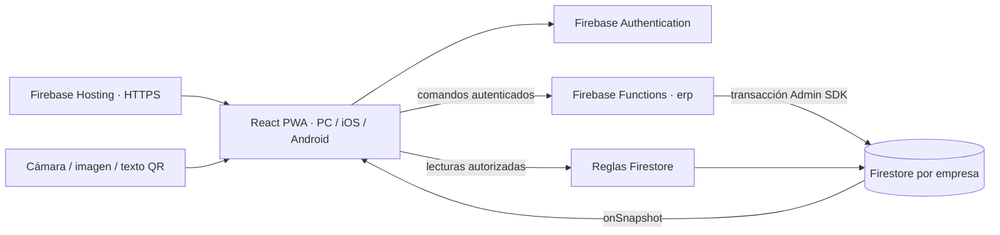

# Arquitectura de EXLAIDER ERP

## Stack y responsabilidades

React y Vite entregan una PWA adaptable para computador, iPhone y Android. La misma base de código contiene formularios, catálogo, módulos administrativos y lectura QR por cámara o imagen. Firebase Hosting proporciona HTTPS. No se entregan aplicaciones nativas publicadas en App Store o Google Play.

Firebase Authentication identifica a cada persona. Cloud Firestore centraliza la información y `onSnapshot` actualiza los equipos conectados. Firebase Functions ejecuta las operaciones con Firebase Admin SDK: valida la membresía, reserva códigos, actualiza existencias y registra movimientos y asientos dentro de transacciones.

Las reglas de Firestore permiten las lecturas del rol y **rechazan todas las escrituras de negocio del navegador**. El backend comprueba usuario, empresa, rol activo, límites, referencias y estado de los documentos. Las credenciales del servidor no se incorporan a variables `VITE_*`.



Functions usa `us-east1`, runtime Node.js 22 y un máximo configurado de cinco instancias. Su publicación requiere el plan **Blaze**. Preparar el código no activa el plan ni modifica la facturación. Los emuladores permiten probar sin publicar Functions en el proyecto real.

## Estructura

```text
src/
  App.jsx                         Sesión y navegación según rol
  components/
    CatalogPanel.jsx              Referencias, variantes, entradas y migración
    ProductForm.jsx               Producto individual y QR antes de guardar
    ProductQr.jsx / QrScanner.jsx  Generación y lectura QR
    OperationsPanels.jsx          Ventas, compras, producción, finanzas y personal
  hooks/
    useAuth.js                    Sesión y membresía en tiempo real
    useOrgData.js                 Suscripciones limitadas por rol
  lib/
    firebase.js / erpApi.js        Conexión, callable y reintento del comando
    productModel.js / qr.js        Validación de formulario y contrato QR
functions/
  index.js                        Callable erp y comprobación de UID para permisos
  lib/core.js                     Autorización, idempotencia, dinero y asientos
  lib/catalog.js                  Catálogo, stock, costos y migración
  lib/operations.js               Operaciones comerciales y administrativas
  package.json / package-lock.json
firestore.rules                   Lecturas autorizadas; escrituras cliente denegadas
firebase.json                     Functions, Hosting y emuladores
scripts/ / tests/                 Firebase CLI y validación automatizada
```

## Modelo por empresa

Todos los documentos están bajo `organizations/{companyId}`. La empresa proviene de la configuración y se comprueba junto con la membresía; un QR no puede elegir otra empresa.

| Colección | Contenido | Lectura |
| --- | --- | --- |
| `members` | UID, rol y estado activo | Usuario: su documento; administrador: el equipo. |
| `references` | Nombre canónico, referencia, categoría, descripción, tipo y unidad | Administrador y operador; viewer solo productos terminados. |
| `variants` | SKU, alias anteriores, talla, color, lote, precio de venta y stock | Administrador y operador; viewer solo productos terminados. |
| `costs` | Valor de adquisición de existencias y unidades sin valorar | Administrador. |
| `movements` | Cantidades, origen, motivo y responsable; sin costos | Administrador y operador. |
| `sales`, `purchases`, `payments` | Documentos comerciales y pagos registrados | Administrador. |
| `productionBoms`, `productionOrders` | Recetas, consumos y órdenes | Administrador. |
| `employees`, `attendance`, `payroll` | Personal, asistencia y nómina interna | Administrador. |
| `contacts` | Clientes y proveedores | Administrador. |
| `journals`, `financeEntries` | Asientos y caja registrada | Administrador. |
| `audit`, `commands`, `migrations` | Auditoría, idempotencia y control de migración | Administrador. |
| `variantSkuIndex`, `variantCombinationIndex` | Unicidad de SKU y combinación | Solo backend. |
| `employeeDocumentIndex`, `payrollPeriodIndex` | Unicidad de documento y período de nómina | Solo backend. |
| `products`, `skuIndex` | Datos anteriores conservados para migración | Productos: miembros activos; índice: backend. Sin escrituras cliente. |

### Referencia y variantes

`JN-101` y `jn-101` reservan el mismo encabezado `r_jn-101`. Crear otra variante exige el mismo nombre normalizado. El encabezado es la fuente única de nombre, categoría, descripción e imagen. Administrador y operador pueden corregir esos datos comunes; la referencia, el tipo y la unidad permanecen definidos para todas sus variantes.

Cada combinación normalizada de referencia/talla/color/lote es única, aunque se intente registrar con otro SKU. Los SKU anteriores de una variante permanecen reservados a ella: cambiar el código no permite que una etiqueta antigua identifique otro producto. `skuAliases` conserva hasta 50 códigos anteriores normalizados.

Ejemplo ficticio de `references/r_jn-101`:

```json
{
  "code": "JN-101",
  "name": "Jean cargo para hombre",
  "nameKey": "jean cargo para hombre",
  "category": "Jeans",
  "description": "Referencia de jean cargo",
  "imageUrl": "",
  "kind": "finished",
  "unit": "unidad"
}
```

Ejemplo de una variante; otra talla/color utiliza otro documento y SKU, con el mismo `referenceKey`:

```json
{
  "referenceKey": "r_jn-101",
  "kind": "finished",
  "sku": "JN-101-30-AZ-L1",
  "skuKey": "jn-101-30-az-l1",
  "skuAliases": [],
  "size": "30",
  "color": "Azul",
  "lot": "L1",
  "priceCents": 9500000,
  "stock": 18,
  "minStock": 5,
  "active": true
}
```

Las fechas reales se guardan como Timestamp de Firestore, con `createdAt`, `updatedAt`, `createdBy` y `updatedBy` según el documento. Los movimientos y documentos comerciales conservan nombre/SKU históricos para que una corrección del catálogo no reescriba el pasado.

### Cantidades y dinero

Las cantidades son enteras entre cero y 1.000.000.000. Productos terminados: `unidad`; materiales: `unidad`, `cm` o `g`. Por ejemplo, 2,5 metros se expresan como 250 cm.

Los importes nuevos son enteros en **centavos de COP**, con sufijo `Cents`: `9500000` representa 95.000 COP. El frontend convierte pesos a centavos; el backend calcula productos y proporciones con enteros/BigInt y controla límites. El precio de venta no se usa para adivinar el costo.

El documento privado `costs/{variantId}` almacena `stockValueCents` y `unvaluedQuantity`. Para 18 unidades a costo promedio de 50.000 COP, el valor es `90000000` y las unidades sin valorar son cero. Un ingreso sin costo informado conserva el valor anterior y marca todas las unidades ingresadas como pendientes. Un costo cero informado expresamente se distingue de un costo desconocido. El administrador puede valorar el stock actual con `stock.value`, sin alterar su cantidad y con el asiento de ajuste correspondiente.

### Comando transaccional

```json
{
  "companyId": "exlaider-jeans",
  "action": "stock.receive",
  "requestId": "uuid-de-la-operacion",
  "payload": {
    "variantId": "id-de-la-variante",
    "quantity": 3,
    "reason": "Ingreso verificado en bodega"
  }
}
```

El UID procede del token de Authentication. `withCommand` lee membresía y comando, valida el rol y guarda resultado y auditoría junto con la operación. Repetir el mismo `requestId`, actor, acción y contenido devuelve el resultado registrado; reutilizarlo con otros datos se rechaza.

Los servicios completan las lecturas antes de escribir. Firestore reintenta ante cambios concurrentes. Dos ingresos de 3 y 4 sobre un stock de 10 producen 17; editar metadatos no escribe stock. El cliente conserva el ID en su reintento automático de respuesta perdida. Dos confirmaciones manuales con IDs distintos son dos operaciones: ante una respuesta incierta se debe revisar el historial antes de repetir.

## Contabilidad y trazabilidad

Las operaciones valoradas generan asientos balanceados junto con el stock y los documentos relacionados. Las cuentas separan caja, cartera, materiales, producción en proceso, producto terminado, proveedores, nómina, ingresos y gastos. Las anulaciones registran movimientos/asientos compensatorios y conservan los originales.

Los pagos son registros internos: no hacen transferencias ni cobros externos. La nómina usa salario y ajustes introducidos; no calcula obligaciones legales ni transmite nómina electrónica. No se emite factura electrónica DIAN ni se certifica cumplimiento contable, tributario o laboral sin parametrización e integración profesional.

## Lecturas, QR y límites

`useOrgData` escucha solo las colecciones permitidas. Al cambiar UID/rol descarta el estado anterior y cancela las escuchas. El viewer consulta `kind == finished`, conforme a las reglas.

El operador conserva precio unitario de venta y stock, pero no consulta costos/finanzas ni ve la tarjeta agregada de valor. Puede calcular por su cuenta un valor de venta con los datos unitarios visibles; ocultar la tarjeta no vuelve secreta esa operación matemática. El viewer mantiene su consulta y valor de venta del catálogo, sin costos privados.

Los QR identifican por ID/SKU o prellenan campos permitidos, incluidos tipo y unidad. Los QR anteriores siguen siendo compatibles; por defecto representan producto terminado/unidad. No incluyen costos privados, no conceden permisos ni cambian de empresa. Prepararlos no guarda documentos y una etiqueta antigua no sustituye el stock vigente. Véase [FIREBASE_Y_QR.md](FIREBASE_Y_QR.md).

Las escrituras requieren Internet. La caché PWA no garantiza transacciones offline. La cámara necesita HTTPS, permiso y navegador compatible; las pruebas automatizadas no sustituyen las pruebas en teléfonos físicos. Para grandes volúmenes se requiere paginación y una estrategia de índices/retención, en lugar de escuchar indefinidamente todos los documentos.

Durante la transición, crear una referencia/variante, corregir su encabezado o migrar comprueba también las referencias de `products`. Como la versión anterior no tenía índice normalizado, el backend lee una proyección de referencia/nombre en páginas de 200 y consulta las variantes de los IDs coincidentes. Normaliza NFKC, espacios exteriores y mayúsculas; ignora las copias cuyo ID ya está migrado. Así una referencia anterior pendiente tampoco puede identificar otro producto ni permitir un cambio de nombre que la contradiga.

Esta comprobación cuesta lecturas proporcionales al catálogo anterior, incluso mientras se conserven copias ya migradas; el límite de página no reduce la facturación total. Para un catálogo histórico grande se necesita preparar un índice normalizado de compatibilidad antes de ampliar el volumen. No se eliminan documentos anteriores para omitir la validación.

Instalación, operación y migración: [ERP.md](ERP.md) y [LEEME_VSCODE.md](../LEEME_VSCODE.md).

## Publicación y dependencias

Hosting ejecuta `scripts/check-deploy.mjs` antes de publicar. Comprueba configuración completa, coincidencia con el proyecto seleccionado, metadatos de compilación en modo producción y activos construidos con los mismos valores públicos. Así se rechaza publicar por accidente una pantalla sin configurar o una compilación de emuladores. `build-info.json` contiene sólo modo y proyecto público.

El SDK Firebase13 fijaba una dependencia Node de gRPC anterior a sus correcciones de seguridad. `package.json` aplica un override compatible de `@grpc/grpc-js`1.14.6 dentro de `@firebase/firestore`; ambos lockfiles fijan dependencias reproducibles. Las comprobaciones de reglas/navegador deben ejecutarse después de actualizar dependencias.
