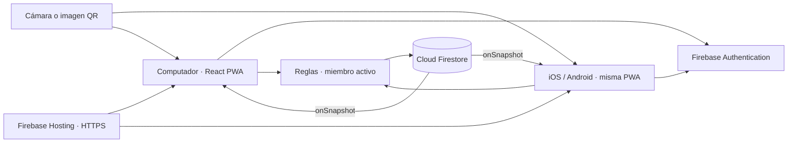

# Arquitectura, estructura y modelo de datos

## Decisión de arquitectura

React + Vite se conserva como base y se distribuye como PWA adaptable. Computador, iPhone y Android comparten formularios, validación, lectura QR y acceso a datos. Para este proyecto web existente, migrar a Flutter o React Native añadiría una reescritura sin ser necesaria para cámara e inventario.

Firebase Authentication identifica a cada persona. Firestore almacena los productos y comunica los cambios mediante `onSnapshot`. Sus reglas comprueban permisos y campos en el servidor: ocultar un botón en React no impide que alguien intente una escritura por otra vía.

El backend de esta entrega son los servicios administrados y las reglas de Firebase. No requiere un servidor propio Express o WebSocket. Una fase futura puede usar Cloud Functions o Cloud Run para integraciones comerciales y operaciones privilegiadas, con credenciales exclusivamente de servidor.



La sincronización ocurre cuando Firestore acepta una escritura y notifica a los demás clientes. La latencia depende de Internet. No se garantiza un tiempo máximo universal ni operaciones de stock sin conexión.

## Estructura

```text
appwebInnovacion/
├── src/                    Interfaz, formularios, QR y servicios Firebase
├── public/                 Manifest e iconos de la PWA
├── docs/
│   ├── ARQUITECTURA.md
│   ├── FIREBASE_Y_QR.md
│   └── EXLAIDER_ALCANCE.md
├── tests/                  Modelo, QR, operaciones y permisos
├── .env.example            Configuración web de ejemplo
├── firebase.json           Hosting, reglas y emuladores
├── firestore.rules         Autorización y validación de datos
├── firestore.indexes.json
├── package.json
├── package-lock.json
└── LEEME_VSCODE.md
```

| Archivo | Responsabilidad |
| --- | --- |
| `src/lib/firebase.js` | Configuración de Auth, Firestore, empresa y emuladores. |
| `src/lib/productModel.js` | Validación de campos y normalización de SKU. |
| `src/lib/products.js` | Consultas, suscripciones y transacciones de inventario. |
| `src/lib/qr.js` | Interpretar y generar el contenido QR versionado. |
| `src/components/QrScanner.jsx` | Cámara, imagen y resultado de lectura. |
| `src/components/ProductQr.jsx` | Representar la etiqueta del producto. |
| `src/hooks/useAuth.js` | Escuchar sesión y membresía activa. |
| `src/hooks/useProducts.js` | Suscripción `onSnapshot` y estado de conexión. |
| `scripts/approve-emulator.mjs` | Aprobar una cuenta de pruebas solo en el emulador local fijo. |
| `src/App.jsx` | Sesión, formularios, catálogo y operaciones de usuario. |

La interfaz coordina formularios y presenta errores. Los servicios mantienen las operaciones compartidas y la cámara se libera al cerrar.

## Modelo de base de datos

Firestore es documental. La empresa está en la ruta, no en un filtro que pueda olvidarse:

```text
organizations/
  exlaider-jeans/
    products/
      {productId}
    skuIndex/
      {skuDocumentKey}
    members/
      {firebaseAuthUid}
```

### Producto

Documento `organizations/exlaider-jeans/products/{productId}` expresado en JSON:

```json
{
  "name": "Jean cargo azul",
  "sku": "EX-JN-101-32-AZ-L001",
  "skuKey": "ex-jn-101-32-az-l001",
  "description": "Jean cargo para hombre, variante azul talla 32.",
  "category": "Jeans",
  "reference": "JN-101",
  "size": "32",
  "color": "Azul",
  "lot": "L001",
  "imageUrl": "https://ejemplo.com/jean-azul.jpg",
  "currency": "COP",
  "price": 95000,
  "stock": 18,
  "minStock": 5,
  "createdAt": "2026-10-14T12:00:00Z",
  "updatedAt": "2026-10-14T12:00:00Z",
  "createdBy": "uid-del-operador",
  "updatedBy": "uid-del-operador"
}
```

Las fechas son cadenas solo para leer este ejemplo: el código guarda **Timestamp de Firestore** mediante `serverTimestamp()`. `productId` es el ID del documento y se incorpora al objeto leído como `id`. Los valores son ficticios y no representan stock o precios reales de la empresa.

| Campo | Propósito |
| --- | --- |
| `name`, `description` | Información de la prenda. |
| `sku`, `skuKey` | Código único y clave normalizada en minúsculas del índice. |
| `category` | Jeans, Camuflados, Bermudas u otra categoría. |
| `reference`, `size`, `color`, `lot` | Identificación de la variante textil que se cuenta por separado. |
| `imageUrl` | URL HTTPS opcional. No es una subida de fotos a Storage. |
| `currency`, `price` | Moneda COP y precio unitario. |
| `stock`, `minStock` | Cantidades enteras no negativas. |
| `createdAt`, `updatedAt` | Fecha del servidor. |
| `createdBy`, `updatedBy` | UID del responsable autenticado. |

En una futura integración contable se debe acordar el manejo de unidades monetarias y redondeo. La presentación actual utiliza formato de pesos colombianos.

### Índice único de SKU

La colección `skuIndex` relaciona una clave de SKU normalizada con `productId`. El ID lleva el prefijo `s_`; por ejemplo, `s_ex-jn-101-32-az-l001`. El servicio reserva el código y guarda el producto en una transacción. Consultar primero si existe un código y guardar después permitiría que dos equipos crearan un duplicado simultáneamente.

Las operaciones de creación, cambio de código y eliminación deben mantener ese índice. No se recomienda guardar documentos directamente desde la consola para la carga habitual: se omitirían la validación de la aplicación y el protocolo del índice.

### Miembro y permisos

Documento `organizations/exlaider-jeans/members/{firebaseAuthUid}`:

```json
{
  "role": "operator",
  "active": true
}
```

| Rol | Uso |
| --- | --- |
| `admin` | Administración del inventario, incluida la eliminación de productos. |
| `operator` | Registro, edición y recepción de unidades; no elimina productos. |
| `viewer` | Clientes aprobados u otros usuarios de consulta. |

Crear una cuenta de Authentication no crea una membresía. Los clientes no pueden escribir `members`, ni siquiera solicitarse un rol `admin`; la autorización se hace desde Firebase Console por un administrador del proyecto.

Los lectores autorizados acceden a documentos completos de producto. Firestore no esconde campos individuales dentro de un documento leído. Si se incorporan costos internos u otros datos que un cliente no deba conocer, deberán separarse en documentos con permisos diferentes.

## Código central de tiempo real

El patrón de suscripción es:

```js
import { collection, onSnapshot } from 'firebase/firestore'

function subscribeProducts(db, companyId, onProducts, onError) {
  return onSnapshot(
    collection(db, 'organizations', companyId, 'products'),
    (snapshot) => {
      onProducts(snapshot.docs.map((item) => ({
        ...item.data(),
        id: item.id,
      })))
    },
    onError,
  )
}
```

`db` es la instancia inicializada con la configuración del proyecto. React inicia la suscripción después de comprobar la sesión y el miembro activo. Al cerrar sesión o desmontar el componente, ejecuta la función que devuelve `onSnapshot` para cancelar la escucha. La interfaz no conserva el inventario de otra sesión.

El celular y el computador escuchan la misma colección; no se transfieren archivos entre ellos. Para un volumen grande será necesario añadir consultas paginadas e índices específicos, en lugar de escuchar todos los productos de la empresa.

## Entradas simultáneas

Una entrada recibe un producto existente y una cantidad positiva. El servicio `receiveProduct(uid, id, quantity)` usa una transacción que lee su stock actual, calcula el nuevo valor, valida el rango y actualiza cantidad, fecha y UID. La edición de características conserva el stock reciente; las entradas se registran por su operación específica. Si otra persona modifica el documento durante la lectura, Firestore reintenta con el estado reciente.

Con un stock de 10, recibir simultáneamente 3 y 4 unidades debe producir 17. Los controles se bloquean durante el envío y el lector entrega una detección por sesión activa para evitar repetir fotogramas. Esto no equivale a idempotencia global ante dos confirmaciones voluntarias independientes; una futura colección de movimientos podría asignar IDs únicos de recepción.

## Contrato QR

Se admiten SKU simples y el formato JSON versionado de la aplicación: `v: 1`, `type: "inventory-product"`, `id` y/o `sku`, con campos opcionales en el mismo nivel para prellenar. No hay un envoltorio `data`. El QR no contiene credenciales ni permisos.

La búsqueda se restringe siempre a la empresa configurada de la sesión. Un QR no selecciona otra empresa. El registro actual de Firestore tiene prioridad sobre datos impresos: el precio o stock incluidos en una etiqueta no sustituyen los valores vigentes de un producto existente.

El flujo es detectar → interpretar → consultar → revisar → confirmar. No se ejecuta contenido ni se abren enlaces automáticamente. Por defecto la detección abre la revisión; si el operador activa «Ingreso directo», una lectura de un producto existente suma una unidad mediante la misma transacción. La cámara se detiene al detectar/cerrar; existen alternativas de imagen y texto.

## Límites

- Una base de código web y PWA; no se entregan aplicaciones nativas publicadas en tiendas.
- El uso cloud requiere proyecto Firebase, reglas y miembros aprobados.
- La cámara requiere HTTPS, permisos y hardware compatible.
- La caché de la interfaz no garantiza transacciones de inventario sin Internet.
- La fecha y UID de última modificación no son un historial completo de entradas/salidas.
- CRM, ventas, costos y rotación requieren módulos y fuentes de datos adicionales.
